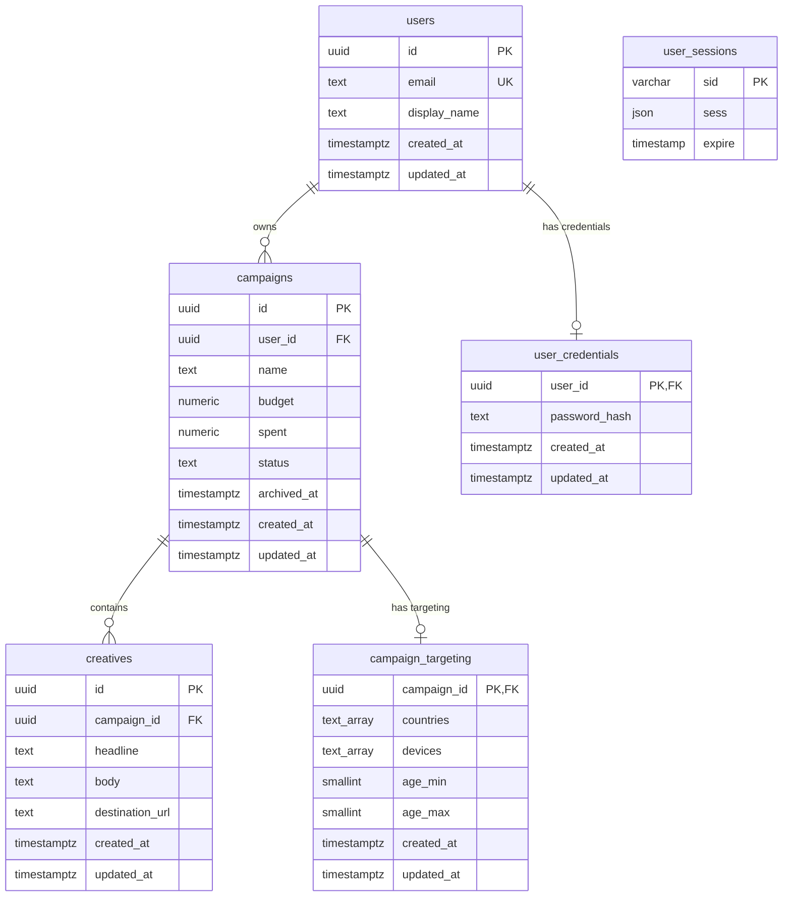

# Database Design

AdPulse Core uses PostgreSQL as its primary persistence layer.

The data model is relational because users, campaigns, creatives, targeting, and authentication data have clear ownership and integrity relationships.

---

## Main Relationships

Conceptually:

```text
users
  │
  └── campaigns
        │
        ├── creatives
        │
        └── campaign_targeting
```


Authentication data is associated with users separately.

---

# Users

Users represent application identities.

Campaigns reference their owner through:

```text
campaigns.user_id
→ users.id
```

Ownership is enforced both through foreign keys and owner-scoped application queries.

---

# Campaigns

Campaigns contain business information such as:

```text
id
user_id
name
budget
spent
status
archived_at
created_at
updated_at
```

Important constraints protect invariants at the database level where appropriate.

Examples include valid campaign statuses and budget-related constraints.

---

# Creatives

Creatives reference their campaign:

```text
creatives.campaign_id
→ campaigns.id
```

This creates a one-to-many relationship:

```text
one campaign
→ many creatives
```

The application additionally restricts new creative creation to DRAFT campaigns.

That business-state rule belongs in the service layer rather than only in the database.

---

# Campaign Targeting

Targeting uses a one-to-one relationship with campaigns.

The targeting table uses:

```text
campaign_id
```

as both:

```text
primary key
foreign key
```

This guarantees at most one targeting configuration per campaign.

Targeting stores:

```text
countries
devices
age_min
age_max
```

Constraints validate:

- supported age range
- minimum age not greater than maximum age
- allowed device values

Deleting the parent campaign is configured to cascade to targeting where appropriate.

---

# Missing Targeting Semantics

A missing targeting row is not treated as an error.

It means:

```text
unrestricted targeting
```

Application code translates absence into:

```text
countries: []
devices: []
ageMin: null
ageMax: null
```

This avoids creating unnecessary database rows for default state.

---

# Foreign Keys

Foreign keys protect relational integrity.

Examples:

```text
campaigns.user_id
→ users.id

creatives.campaign_id
→ campaigns.id

campaign_targeting.campaign_id
→ campaigns.id
```

This prevents orphaned references.

---

# Parameterized SQL

Repository queries use parameterized SQL.

Conceptually:

```sql
SELECT *
FROM campaigns
WHERE user_id = $1
  AND id = $2;
```

rather than string-building values directly into SQL.

This reduces SQL injection risk and keeps query construction predictable.

---

# Owner-Scoped Queries

Ownership is included directly in campaign queries.

Example pattern:

```text
findByIdForUser(userId, campaignId)
```

corresponds conceptually to:

```sql
SELECT *
FROM campaigns
WHERE user_id = $1
  AND id = $2
  AND archived_at IS NULL;
```

Instead of:

```text
load campaign by ID
→ return it to application code
→ check owner later
```

ownership is part of the persistence boundary itself.

---

# Indexes

Indexes were added based on actual access patterns.

Important examples include:

```text
campaigns(user_id, created_at DESC)
```

This supports listing one user's campaigns in creation order.

Another example:

```text
creatives(campaign_id, created_at ASC)
```

This supports retrieving creatives for one campaign in deterministic order.

The project intentionally avoids indexing every column without a query-driven reason.

---

# Query Planning

PostgreSQL `EXPLAIN` can be used to inspect how queries are executed.

Important concepts explored include:

```text
sequential scans
index scans
filtering
sorting
joins
row estimates
```

Indexes are treated as performance tools rather than automatic requirements.

---

# Joins and Aggregation

The project uses relational SQL concepts including:

- joins
- grouping
- null handling
- aggregation
- one-to-many fan-out

A key lesson is that joining multiple one-to-many relationships can multiply rows.

For example:

```text
campaign
× creatives
× another child table
```

may produce more rows than expected.

Aggregation must therefore account for join cardinality.

---

# Transactions

Transactions protect multi-step writes.

For example:

```text
create campaign
create initial creative
```

must not leave a campaign without its required initial creative if the second insert fails.

The service requests a transaction from the transaction manager.

All repositories inside that transaction use the same PostgreSQL client.

```text
PoolClient
  ↓
CampaignRepository
CreativeRepository
```

This ensures all statements participate in the same database transaction.

---

# Migration System

Database schema changes are stored as numbered SQL migration files.

The migration runner:

1. discovers migration files
2. sorts filenames deterministically
3. calculates a SHA-256 checksum
4. checks `schema_migrations`
5. runs unapplied migrations inside transactions
6. records successful application

Applied migration information includes:

```text
filename
checksum
applied_at
```

---

# Migration Immutability

Once a migration has been applied, it should not be edited.

The checksum system detects modifications.

If the current checksum differs from the stored checksum, migration execution stops.

The correct way to modify an existing schema is:

```text
create a new migration
```

rather than rewriting history.

---

# Reproducibility

A fresh database should be constructible by applying all migrations in order.

This makes schema state reproducible across:

```text
development
testing
future deployment environments
```

---

# Test Database Safety

Integration tests use a dedicated database:

```text
adpulse_test
```

Before resetting tables, test utilities execute:

```sql
SELECT current_database();
```

The reset proceeds only if the result is exactly:

```text
adpulse_test
```

Otherwise it throws an error.

This guard was added to prevent automated tests from truncating normal development data.

---

# Database Design Principles

```text
Use foreign keys for relational integrity.

Use constraints for durable invariants.

Keep business-state rules in services.

Use owner-scoped queries for authorization boundaries.

Use indexes for demonstrated access patterns.

Use one transaction connection for compound writes.

Never rewrite applied migrations.

Use a dedicated test database with destructive-operation guards.
```